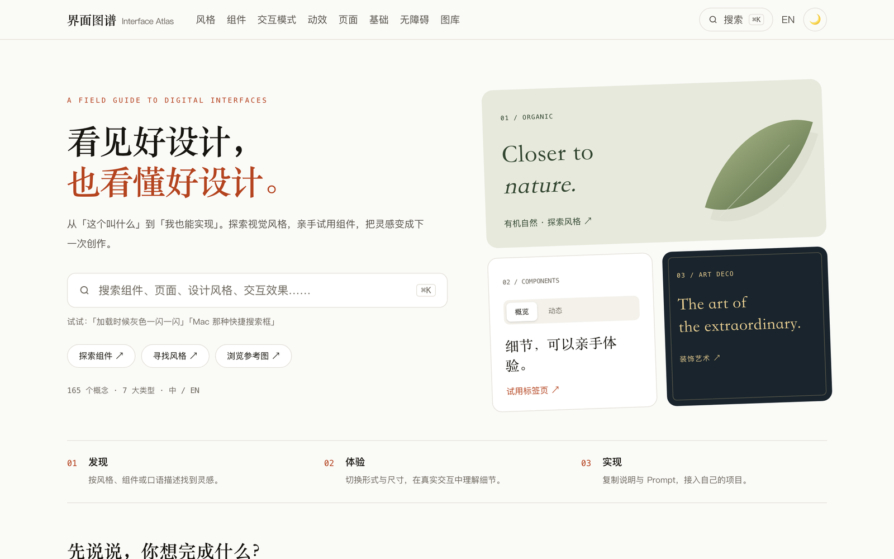

# 界面图谱 Interface Atlas · Web 构建产物

前端设计概念百科的公开构建与 GitHub Pages 部署仓库：从口语描述找到专业术语，每个概念都带可运行的 Live Demo。源仓库为私有的 `gongfpp/interface-atlas`。

<p align="center">
  
</p>

**在线访问：** <https://gongfpp.github.io/interface-atlas-web/>


## 说明

- 本仓库为可公开的静态运行/构建产物，不包含私有源码、测试与评审素材。
- 仓库未附开源许可，代码、文案与素材未授予额外复用许可；第三方引擎与字体按其自带许可使用。

## 本地运行

静态站点，任意静态服务器即可：

```bash
python3 -m http.server 8080
# 浏览器打开 http://localhost:8080/
```
